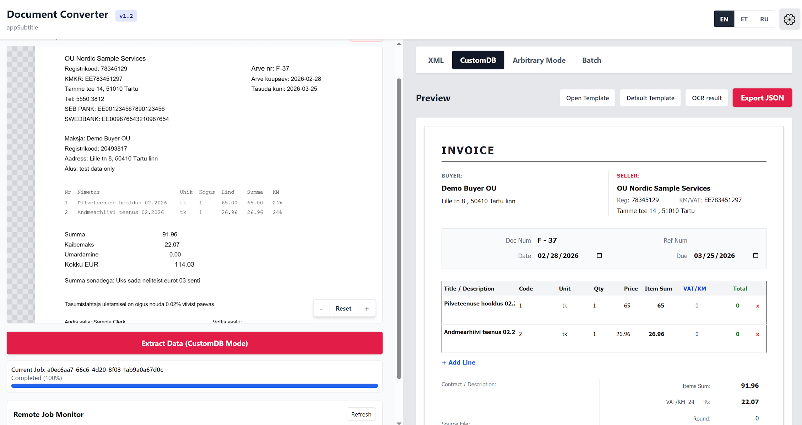
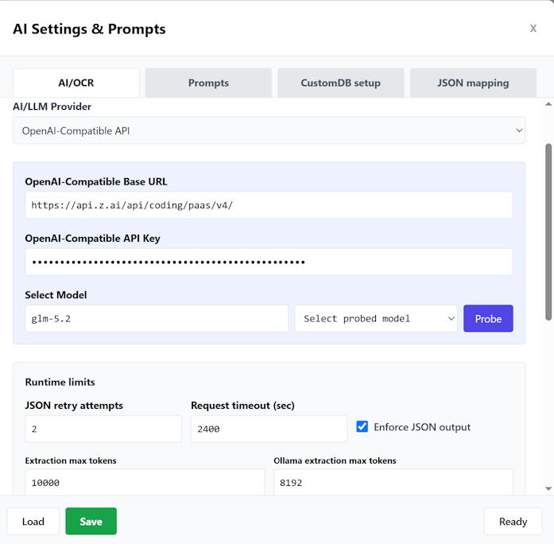
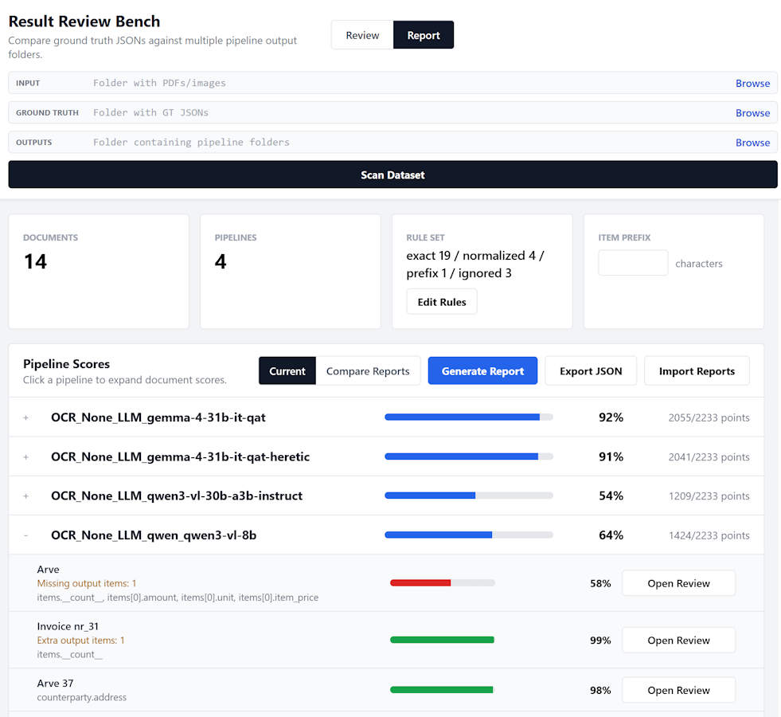

# Document Converter App
[](https://ryoma-uedev.github.io/Document_Converter_Engine/)
[](LICENSE)

A local-first document extraction tool with a FastAPI backend and browser workstation, mainly meant to be plugged into an automation workflow (for example, as an n8n worker). Upload a PDF or image, run OCR and/or a vision-capable LLM, review the structured result, map fields into a target schema, and export JSON.

This public branch is a portfolio version of the project, focused on demonstrating the extraction workflow, provider setup, testing approach, and comparison tests for different extraction pipelines.

Test results and pipeline comparison report: **[GitHub Pages Report](https://ryoma-uedev.github.io/Document_Converter_Engine/)**

The backend can run as a document-conversion engine without the bundled frontend. External automation tools can submit files through the API, while the frontend acts as a workstation/admin surface for review, job monitoring, settings, prompts, schemas, and mapping.

The app works with invoices and other structured documents. The UI supports English, Estonian, and Russian. It has mostly been tested on Windows with LM Studio, so Linux may still have some issues.

## Quick Start

**Windows, portable standalone Python**

```bat
Win\setup_requirements.bat
Win\serverstart.bat
```

**Windows, existing Python install**

```bat
Win\serversetup.bat
Win\serverstart.bat
```

**Linux**

```bash
python3 -m venv .venv
source .venv/bin/activate
pip install -r backend/requirements.txt
python -m uvicorn backend.server:app --host 0.0.0.0 --port 8000
```

Open `http://localhost:8000/`

Local settings are stored in `earve_settings.json`. You can set up and save new settings from the frontend, or copy `earve_settings.example.json` for a quick start.

## Demo / Screenshots



*Frontend UI — converted document and result pane.*



*Settings modal — provider and OCR configuration.*



*Result Review Bench — side-by-side comparison and quick validation.*

## Features

- Browser UI served by the backend from `frontend/index.html`.
- Backend API for direct automation without the bundled frontend.
- PDF and image upload with client-side preview, zoom, and pan.
- Provider support: OpenAI-compatible APIs, LM Studio, and Ollama.
- OCR options: none, Google Cloud Vision, OpenAI-compatible VLM, LM Studio VLM, or Ollama VLM.
- In-memory job queue with progress, raw OCR text, raw OCR response, raw model response, and parsed result.
- Settings UI for provider credentials, models, OCR provider, prompts, CustomDB schema, and JSON mapping.
- Editable CustomDB viewer template in `frontend/customdb-viewer.html`.
- CustomDB prompt injection using `{{CUSTOMDB_SCHEMA_JSON}}`.
- Model probing endpoints for OpenAI-compatible APIs, LM Studio, and Ollama.
- UI language switch between English, Estonian, and Russian.

Tools for testing and viewing/editing results:
Result Review Bench — Lightweight local UI to view source documents side‑by‑side with extracted JSON for quick manual validation. Start (Windows): Tools\Result_Review_Bench\RRB_Start.bat.

PipeRunner — Repeatable batch runner that executes configured OCR+LLM pipelines over a dataset to produce outputs for benchmarking and comparison. See Tools/PipeRunner for usage.

## Benchmarking & Next steps

Benchmarking shows structure vs. character-accuracy trade-offs across OCR/LLM pipelines; see the [full report](https://ryoma-uedev.github.io/Document_Converter_Engine/). Next: integrate the engine as an n8n worker and experiment with reproducing the pipeline inside n8n.

## Tech Stack

| Component | Technology |
|-----------|------------|
| Backend | FastAPI (Python) |
| Frontend | Vue 3 + Tailwind CSS |
| OCR | Google Vision API, Qwen3-VL |
| LLM | OpenAI, Ollama, LM Studio |
| Testing | Playwright, Postman |

## Settings

Settings live in `earve_settings.json`.

Important fields:

- `provider`: `openai`, `lmstudio`, or `ollama`.
- `openAiBaseUrl`, `lmStudioUrl`, `ollamaUrl`: provider endpoints.
- `openAiKey`: API key for OpenAI-compatible hosted providers.
- `ocrProvider`: `none`, `google`, `openai`, `lmstudio`, or `ollama`.
- `pipelineSettings.mode`: `customdb`, `xml`, or `dynamic`.
- `customDbPrompt`: CustomDB extraction prompt. Use `{{CUSTOMDB_SCHEMA_JSON}}` where the schema should be injected.
- `customDbSchema`: target JSON shape for CustomDB extraction, viewer defaults, and export.
- `customJsonMapping`: maps extracted source paths into the CustomDB viewer/schema paths.

If no mapping is configured, fields map to themselves. The Open Template button in the UI can load a local `.html` CustomDB viewer template for the current browser session.

## Providers

| Provider | Type | Use case |
|---|---|---|
| OpenAI-compatible | Cloud / hosted | Hosted APIs, usually best accuracy, requires API key |
| LM Studio | Local | Run local OpenAI-compatible models |
| Ollama | Local | Run local Ollama models through its OpenAI-compatible `/v1` API |

All providers use the same extraction pipeline. Switching provider changes the backend HTTP target, model, and credentials.

## Testing And Benchmarking

Tests live in `Tests/`.

- Postman collection: safe backend API smoke checks and opt-in manual job requests.
- Playwright standalone tests: API shape, frontend load, settings save flow, prompt/schema injection, and language switching.
- Playwright integration tests: live provider probing and one real document job through the UI. Opt-in with `RUN_INTEGRATION=true`.

Run instructions are in `Tests/README.md`.

Benchmarking and review helpers live in `Tools/`.

- `Tools/Result_Review_Bench`: compare pipeline outputs against review data.
- `Tools/PipeRunner`: run configured model/OCR pipelines for repeatable experiments.

## API

Base URL: `http://localhost:8000`

Key endpoints:

- `POST /api/jobs`: submit a PDF or image conversion job.
- `GET /api/jobs/{job_id}`: get job status and result.
- `POST /api/batch/run-once`: run one batch folder scan.
- `GET /api/health`: backend status.

Full reference with request/response examples is in `docs/API.md`. The Postman collection in `Tests/Postman/` also documents the main smoke-test requests.

## Notes

- Jobs are stored in memory only and disappear on backend restart.
- PDF processing currently uses page 1 only.